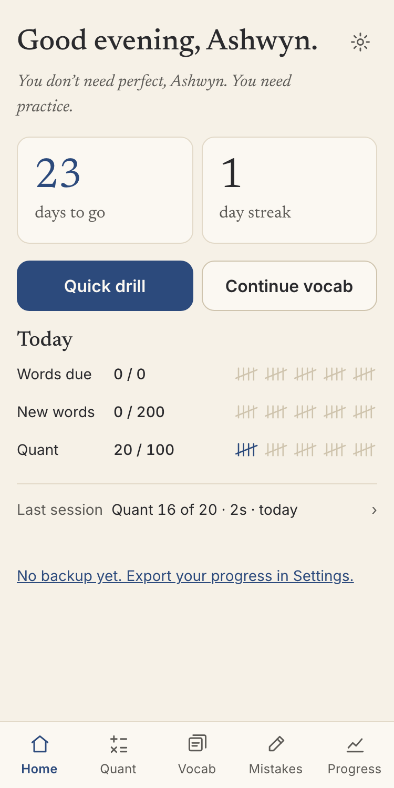
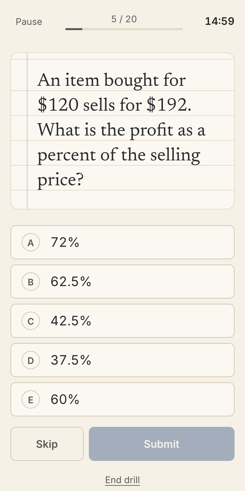
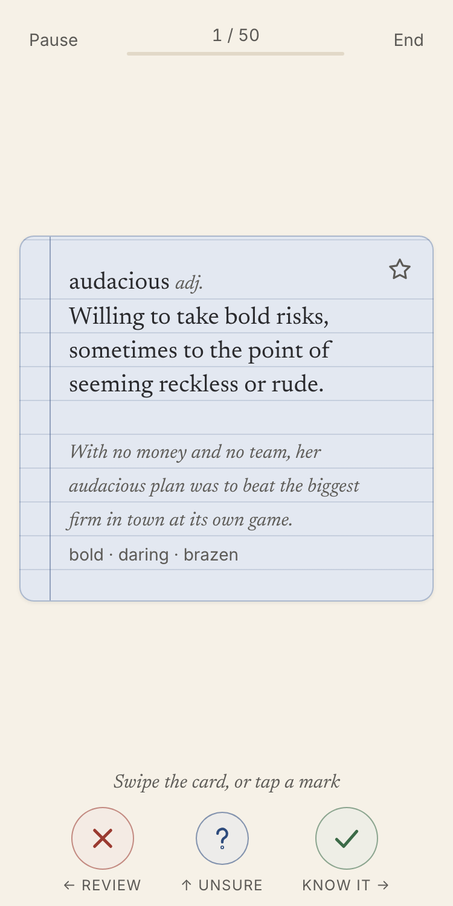
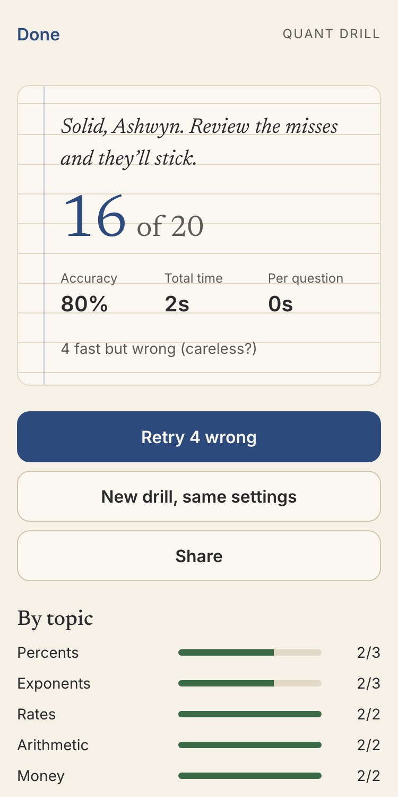
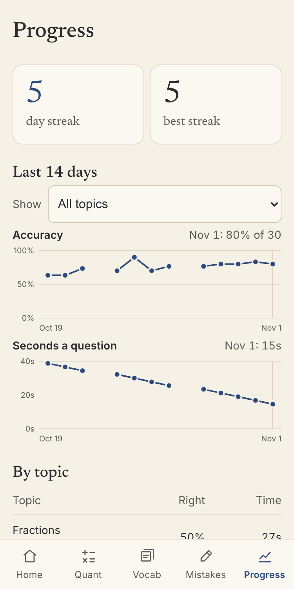
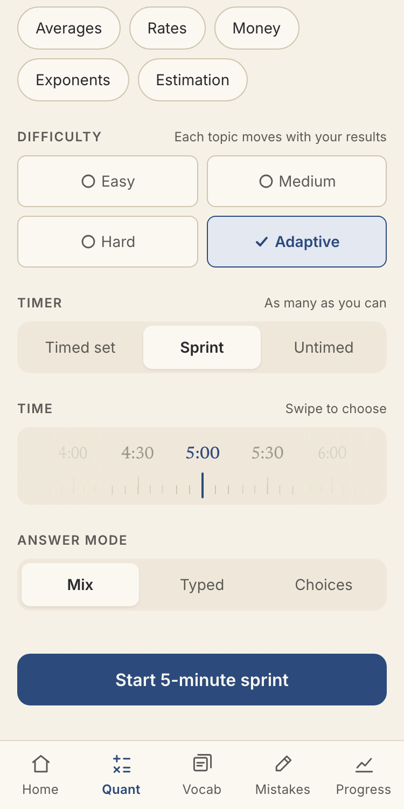
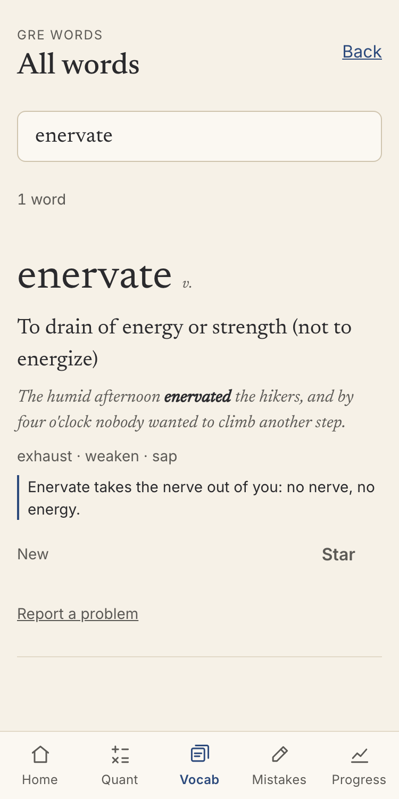
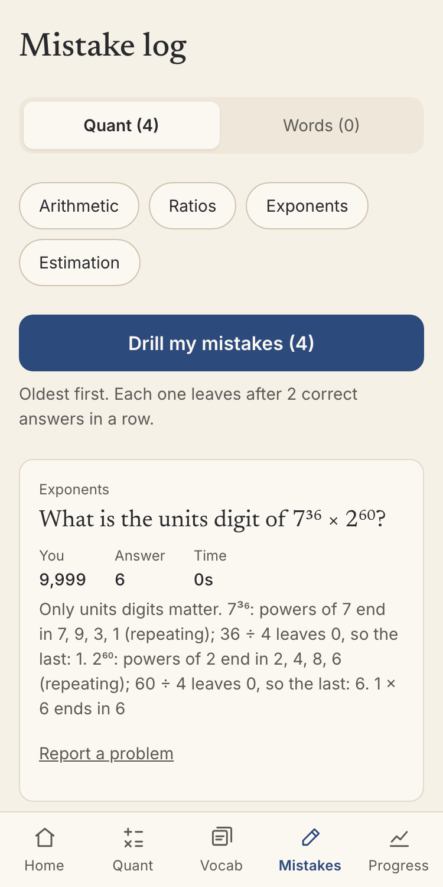

# Graphite

**Fast mental-math drills and high-frequency GRE vocabulary, in a free app that works offline on your phone.**

**Live:** https://ashwynkmr.github.io/graphite/

> **Try it:** open the link on your phone. On iPhone: Share → Add to Home Screen. On Android or desktop Chrome/Edge: Install app. No sign-up.
>
> *Status: **Phase 2 complete, `v2.0.0` (Nov 1, 2026).** Quant drills, sprints, all 1,500 vocab words, the mistake log, a progress dashboard, optional reminders and backup all work today. Real study results aren't in yet.*

  
  
  
  

  
  
  
  

*Screens from an automated test run with made-up study data, so the numbers aren't real results.*

## At a glance

| | At `v2.0.0` |
| --- | --- |
| Content | 1,500 questions with every answer worked out by code; 1,500 words with original meanings and sentences; 231 memory aids |
| Cost and size | $0 a month; 1.9 MB to download, against a 3 MB limit |
| Checks before every deploy | 740 unit tests, 26 browser run-throughs, full content validation |
| Paper trail | 48 decisions, 109 tracked feedback items, 4 retros, 4 releases |
| Real study results | Not yet known: study started Nov 1 |

## The problem

Two people are preparing for the GRE on Nov 24, 2026, with a three-week sprint starting Nov 1. The bottleneck for most test-takers isn't knowing which concept to use: it's arithmetic speed (percents, fractions, ratios, estimation done in the head) and recalling high-frequency vocabulary. Existing tools are paid, cluttered, or built around long multi-step problems that need paper and don't fit a 10-minute session on a phone.

## Users and constraints

- **Two users**, each with a phone and a laptop, no accounts.
- **Phone-first, short sessions** (5–15 minutes), often offline.
- **$0** to build, host and share.
- **Fixed deadline:** study starts Nov 1; the exam is Nov 24. Every day the app isn't usable is a lost study day.
- **Heavy volume:** about 100–200 quant questions and 200 new words a day per user.

## What I built and why

| Need | Feature | Status |
| --- | --- | --- |
| Get faster at calculation | Timed mental-math drills: 1,500 questions across 9 topics, 1,200 generated and 300 hand-written, with every answer worked out by code; pick topics and any mix of Easy/Medium/Hard (Hard = top of GRE mental math) | Live |
| Build speed under pressure | Sprints of 30 seconds to 15 minutes, and Adaptive difficulty that moves each topic up or down with your results | Live |
| Train smart guessing, not just calculation | Typed answers and five-option multiple choice; at least two wrong options per question come from real mistakes (wrong base, adding instead of chaining, ×10 slips) | Live |
| Practise under test conditions | No right/wrong feedback until the session ends; timed sets; the clock pauses when the phone locks | Live |
| Learn from mistakes | Results review every question with a one-line shortcut and a Report a problem link; Retry wrong ones; every miss collects in a mistake log with "Drill my mistakes" | Live |
| Stay motivated for three weeks | Asks for your name once; greets you and cheers you on by name on Home and Results, never mid-drill | Live |
| Learn 1,500 words in three weeks | Swipe flashcards, multiple choice, fill the blank and Sentence Equivalence, mixed in any combination, with Leitner spaced repetition and 200 new words a day | Live |
| Look up and remember hard words | Search all 1,500 words; memory aids for 231 of the hardest; Round 2 goes through them all again, weakest first | Live |
| Practise the exam's two-answer vocab question | Sentence Equivalence from 661 word pairs, each hand-checked in its sentence | Live |
| Know what to do today | Home shows the countdown, streak, today's goals as tally marks and one suggestion from your own results, repeated on Results | Live |
| See whether it's working | 14-day accuracy and speed trends for all topics or one, the three weakest topics, words per stage | Live |
| Keep progress safe | Export and import a backup file; reset progress or everything | Live |
| Share a result | An image card and text summary of a session or the last 7 or 14 days, sent through the phone's share sheet; nothing leaves the device until you choose | Live |
| Get nudged at the right moment | Optional phone notifications timed by how you study; the phone writes each message, and results stay on it | Live |
| Keep a study partner going | Personal notes from Ashwyn, encrypted in the app and opened only by a matching saved name, with one question each night about whether to keep them coming | Live |
| Study anywhere | Installable app that works offline; progress stays on the device | Live |

## Key decisions and trade-offs

| Decision | Why | Record |
| --- | --- | --- |
| Mental-math drills, not full GRE problems | The bottleneck is calculation speed, and long problems don't fit phone sessions | [0001](docs/decisions/0001-mental-math-drills-not-full-gre-quant.md) |
| Generated question bank, not copied questions | Copyright in a public repo, and scraped answer keys can't be trusted | [0002](docs/decisions/0002-generated-question-bank.md) |
| Results only at the end | Mirrors the real test; the review screen and mistake log close the learning loop | [0007](docs/decisions/0007-results-only-at-end.md) |
| No login; progress stays on the device | Zero setup and nothing to host; the cost is no sync between devices | [0008](docs/decisions/0008-no-login-local-progress.md) |
| PWA on GitHub Pages, not app stores | Hard $0 constraint; the cost is a less discoverable install on iOS | [0009](docs/decisions/0009-pwa-on-github-pages.md) |
| Ship drills before all content is done | Nov 1 start date; the bank grew from 1,200 to 1,500 after launch | [0014](docs/decisions/0014-quant-drill-before-handwritten-problems.md) |
| Approve every checkpoint on staging before anything is committed | Feedback lands before changes go public; costs a slower path to live | [0016](docs/decisions/0016-review-gate-staging-before-commit.md) |
| Build Phase 2 on a branch and launch it once | The live app stayed steady for two people studying on it; the cost is users waiting for everything at the end | [0042](docs/decisions/0042-phase-2-on-a-branch-commit-as-we-go.md) |
| Raise every difficulty one level, with Hard at the GRE's ceiling | The first sample's Easy questions weren't worth study time | [0017](docs/decisions/0017-difficulty-up-one-level.md) |
| Hand-check Sentence Equivalence pairs instead of generating them | A listed synonym doesn't always fit a given sentence; the cost is 661 pairs rather than all 1,500 words | [0029](docs/decisions/0029-sentence-equivalence-hand-checked-pairs.md) |
| The phone writes each reminder; the server only sends an empty wake-up | Results never leave the device; the cost is a small service to run, and reminders still depend on it | [0037](docs/decisions/0037-push-reminders-with-on-device-text.md) |
| Encrypt personal notes in the public repo | Private text can ship without being readable there; a name is a weak key, which is acceptable for this content | [0041](docs/decisions/0041-personal-notes-sealed-in-the-app.md) |
| Sprints count only what was answered; Adaptive restarts its count after each move | Unreached questions can't flood the mistake log, and one good drill can't jump two levels; level moves take several Mixed drills | [0043](docs/decisions/0043-sprint-adaptive-and-topic-memory.md) |
| Choose the hardest words for memory aids by judgment | No study data exists yet; the aids may miss the words these two users find hardest | [0044](docs/decisions/0044-round-2-browse-and-memory-aids.md) |
| One chart per measure, one colour, tap a day to read it | Phones have no hover, and nine colours wouldn't read; topics are compared in a table instead | [0046](docs/decisions/0046-progress-dashboard.md) |
| Announce new features on a one-time screen, not a notification | A phone can't show news from a build it hasn't installed; the cost is one extra tap, once | [0048](docs/decisions/0048-whats-new-screen.md) |

All 48 records: [docs/decisions](docs/decisions/README.md).

## How the plan changed

| When | Change | Record |
| --- | --- | --- |
| Planning, Oct 31 | Full GRE quant prep → mental-math drills only | [0001](docs/decisions/0001-mental-math-drills-not-full-gre-quant.md) |
| Planning, Oct 31 | Questions sourced online → generated by code templates | [0002](docs/decisions/0002-generated-question-bank.md) |
| Planning, Oct 31 | Question bank of 1,000 → 1,500, plus a 7-day no-repeat rule | [0003](docs/decisions/0003-1500-question-bank.md) |
| Planning, Oct 31 | Vocab deck of 1,000 at 50 words a day → 1,500 at 200 a day | [0005](docs/decisions/0005-1500-words-200-a-day.md) |
| Build, Oct 31 | Hand-written word problems moved after the quant flow so drills go live on day one | [0014](docs/decisions/0014-quant-drill-before-handwritten-problems.md) |
| Build, Oct 31 | Ship each step straight to live → approve each checkpoint on staging first | [0016](docs/decisions/0016-review-gate-staging-before-commit.md) |
| Build, Oct 31 | Easy/Medium/Hard all moved up one level; a new Hard tier written for all 73 templates | [0017](docs/decisions/0017-difficulty-up-one-level.md) |
| Build, Oct 31 | Name + optional cheer word → name only | [0019](docs/decisions/0019-personal-name-and-encouragement.md) → [0020](docs/decisions/0020-name-only-encouragement.md) |
| Build, Oct 31 | Icon: geometric G → three options → hybrid → cursive pencil → serif g with fountain pen | [0021](docs/decisions/0021-app-icon-serif-g-with-pen.md) |
| Build, Nov 1 | Launch with 600 words → all 1,500 written before launch | [0011](docs/decisions/0011-launch-with-600-words.md) → [0026](docs/decisions/0026-write-all-1500-entries-before-launch.md) |
| Review, Nov 1 | Type-in removed; Sentence Equivalence added | [0028](docs/decisions/0028-remove-type-in-practice.md), [0029](docs/decisions/0029-sentence-equivalence-hand-checked-pairs.md) |
| Build, Nov 1 | In-app reminders only → optional push reminders; the service moved from Northflank to Cloudflare | [0037](docs/decisions/0037-push-reminders-with-on-device-text.md), [0038](docs/decisions/0038-reminder-service-on-cloudflare.md) |
| Build, Nov 1 | Personal notes moved from Phase 2 into Phase 1 | [0041](docs/decisions/0041-personal-notes-sealed-in-the-app.md) |
| Build, Nov 1 | Phase 2 in pieces during the first week → one launch at the end, built on a branch | [0042](docs/decisions/0042-phase-2-on-a-branch-commit-as-we-go.md) |
| Review, Nov 1 | Sprint times of 2, 5 or 10 minutes → a dial from 30 seconds to 15 minutes | [0043](docs/decisions/0043-sprint-adaptive-and-topic-memory.md) → [0045](docs/decisions/0045-sprint-time-dial-and-search-layout.md) |

## Feedback that shaped the product

Every checkpoint ends with Ashwyn testing and answering a few questions; each item gets an ID and is tracked to the change it caused ([docs/feedback](docs/feedback/README.md)).

- **"Easy should actually be medium… the ceiling should be the GRE's hardest" (FB-07)** → all 73 templates rewritten one level up, with a new Hard tier ([0017](docs/decisions/0017-difficulty-up-one-level.md)).
- **"Not all wrong options should be a giveaway" (FB-08)** → every multiple-choice question keeps at least two options from named mistakes; absurd options are dropped ([0018](docs/decisions/0018-distractors-real-mistakes.md)).
- **Ask for my name and personalise the motivation (FB-11, FB-14)** → a one-field first-run screen and name-based lines on Home and Results; an optional cheer word was tried, then removed at Ashwyn's request ([0020](docs/decisions/0020-name-only-encouragement.md)).
- **Pick topics, and mix difficulties (FB-10, FB-15)** → a topic picker with "Mixed: give me anything" and multi-select difficulty.
- **"The multi-select still doesn't work" (FB-20)** → testing through the staging URL showed the logic was fine; the cause was an ambiguous control plus a stale cached build. Fixed with check-mark toggles and an update bar on every tab.
- **"1 1/4 reads like 11/4" (FB-87)** → stacked fractions and raised powers on every screen, with the bank and saved progress untouched ([0040](docs/decisions/0040-stacked-fractions.md)).
- **"If it is [picked], count it as the marked option even if it's not submitted" (FB-96)** → at time-up a picked option now counts, as on the exam ([0043](docs/decisions/0043-sprint-adaptive-and-topic-memory.md)).
- **"The word only shows in the search bar" (FB-102)** → the phone's keyboard was hiding results behind the filters; they now step aside while you search ([0045](docs/decisions/0045-sprint-time-dial-and-search-layout.md)).
- **"The sprint time selection should again be a dial" (FB-103)** → three fixed times became 30 stops from 30 seconds to 15 minutes ([0045](docs/decisions/0045-sprint-time-dial-and-search-layout.md)).
- **"I would like to have the response taken within the notification itself" (FB-92)** → iPhones don't offer that to web apps. Ashwyn heard why and chose to keep it as is: an example of a request that ended in no change.

## What building it taught me

- **Real phones find what browsers can't.** A keyboard hiding search results, a bad fraction, an awkward control: automated checks passed all of these. Phone reviews found them.
- **Write down what a spec leaves out.** "Sprint" and "Adaptive" sounded finished in the PRD. Working through their edge cases exposed a flooded mistake log and a two-level jump before anyone met them.
- **Reading catches what validators can't.** A validator caught a formula giving 35 instead of 31; only reading all 300 problems caught drafting left in prompts.
- **Gate the action, not just the report.** A failed check once didn't stop a commit to a working branch. Nothing went live, and the check now has to pass before the commit can run.

Full retros: [docs/retros](docs/retros/README.md).

## Metrics and outcomes

These are the PRD's targets for Nov 24, 2026. **No results yet**; actuals will be filled in from real usage.

| Metric | Target | Actual |
| --- | --- | --- |
| Quant accuracy (Medium) | ≥ 90% | Not yet known |
| Average time per question (Medium) | Down 30% from week 1 | Not yet known |
| Words in Known or Retired boxes | 1,200 of 1,500 | Not yet known |
| Vocab quiz accuracy | ≥ 85% | Not yet known |
| Repeat rate | No question twice in 7 days outside the mistake log | Not yet known |
| Days used | 20 of the days between start and exam | Not yet known |
| Answer-key errors reported | Fewer than 5 | Not yet known |

## Roadmap and what's next

Phase 1 shipped in three milestones: **A** quant drills (Oct 31, `v0.1.0`, [retro](docs/retros/milestone-a-retro.md)), **B** vocab (Nov 1, `v0.2.0`, [retro](docs/retros/milestone-b-retro.md)), **C** mistake log, progress, settings, share and the launch pass (Nov 1, `v1.0.0`, [retro](docs/retros/milestone-c-retro.md)). Phase 2 (Nov 1, `v2.0.0`, [retro](docs/retros/phase-2-retro.md)) added sprints, adaptive difficulty, Round 2, Browse, memory aids and a trends dashboard, launched all at once. Phase 3 is optional. Details: [ROADMAP](docs/product/ROADMAP.md) · build log: [PROGRESS](docs/PROGRESS.md).

## Tech overview

A static, offline-first PWA: Vite + React 18 + TypeScript (strict), served from GitHub Pages with hash routing. All progress lives in the browser's IndexedDB via Dexie. The one service is a small Cloudflare Worker for opt-in reminders, which holds only a push address and wake-up times, and studying never depends on it. Quant content is generated at build time from seeded code templates, and every answer is computed and re-verified in CI. Scoring, scheduling and generation live in a pure, unit-tested `src/engine/`. GitHub Actions runs typecheck → lint → tests → content validation → build → browser run-throughs → service checks → deploy on every push. Full detail: [TRD](docs/product/TRD.md) · [PRD](docs/product/PRD.md).

## How this was built

AI-assisted: the code and content were written with Claude Code. Ashwyn was product owner: setting direction, priorities and scope, making the trade-off calls recorded in the decision log, and testing each checkpoint on a phone through a staging site before approving it for release.
